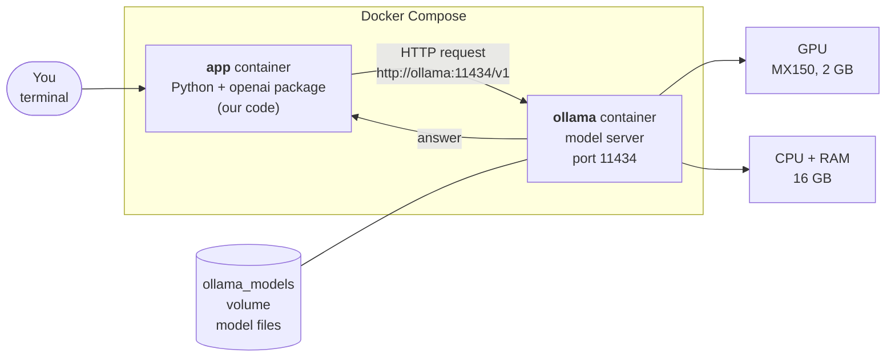
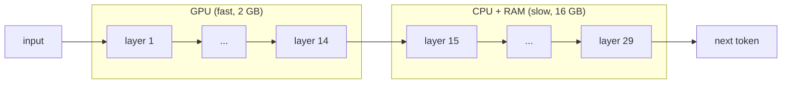

# 1. The setup: two containers, one GPU

## The big picture

Two programs run in two separate containers:

- **ollama** is the *model server*. It loads a model into memory and answers HTTP requests.
- **app** is *our code*. It sends questions to ollama and shows the answers.

They talk over a private network that Docker creates. Inside it, the app finds the
server by its service name: `http://ollama:11434/v1`.



## Why the `/v1` at the end?

Ollama speaks two "languages": its own API (`/api/...`) and a copy of OpenAI's API
(`/v1/...`). We use the OpenAI one, so the same code could later talk to a bigger
server or a cloud model by changing only the address and model name.

## Where does a model run: GPU, CPU, or both?

A model is a stack of **layers**, and each layer is a big block of numbers (the weights).
To produce one token, the input passes through every layer in order.

- The **GPU** is fast at this maths, but our MX150 has only 2 GB of memory.
- Whatever doesn't fit on the GPU stays in normal RAM and runs on the **CPU**, which is
  much slower.



Besides the weights, memory also holds the **KV cache**: the model's working memory
for the conversation. It is sized for the whole context window (4096 tokens), even
when the conversation is short.

### How to check

```bash
docker compose exec ollama ollama ps
```

The `PROCESSOR` column shows the split, for example `49%/51% CPU/GPU`.
`100% GPU` would be the fastest. The server log has the details:

```bash
docker compose logs ollama | grep -E "offloaded|KV buffer"
# offloaded 14/29 layers to GPU
# llama_kv_cache: size = 448.00 MiB
```

### What we measured (step 1)

| Model | File size | In memory | Split (CPU/GPU) | Speed |
|---|---|---|---|---|
| qwen3:1.7b | 1.4 GB | 1.9 GB | 49% / 51% | ~16 tokens/s |
| qwen3:4b-q4_K_M | 2.5 GB | 3.3 GB | 73% / 27% (7/37 layers) | ~6 tokens/s |

Even the small model doesn't fully fit, because memory = weights + KV cache + working
buffers, and Ollama keeps a safety margin. More in [to-explore.md](to-explore.md).
