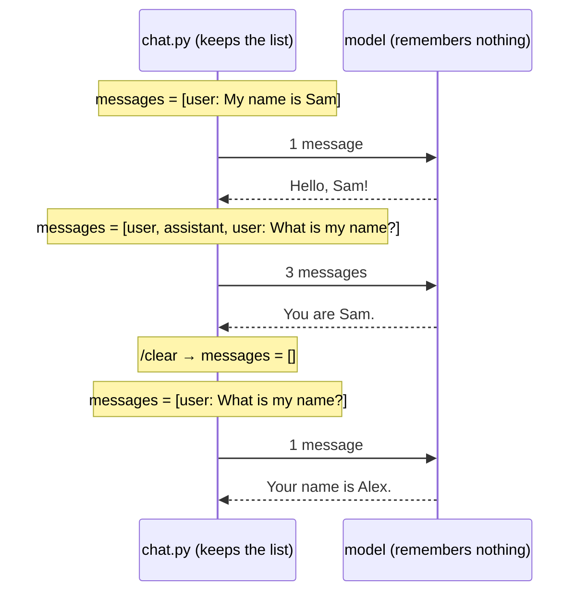

# 2. The model has no memory

A chat feels like a conversation with someone who remembers. It isn't: the model
remembers nothing between requests. **The program keeps the conversation and sends
all of it, every time.** [`chat.py`](../chat.py) does exactly this, in about 100 lines.

## The whole trick: one list

```python
messages = []
messages.append({"role": "user", "content": "My name is Sam."})
answer = ask(messages)                       # sends the WHOLE list
messages.append({"role": "assistant", "content": answer})
```

Each turn adds two entries, and each request sends the entire list:



## What we saw (qwen3:1.7b, thinking off)

```
>>> My name is Sam. Reply in one short sentence.
Hello, Sam! How can I assist you today?

>>> What is my name? One short sentence.
You are Sam.

>>> /clear
(history cleared: the model now knows nothing about this chat)

>>> What is my name? One short sentence.
Your name is Alex.
```

After `/clear` the model doesn't say "I don't know": it **invents** a name. The same
gap-filling as in [experiment 001](experiments/001-what-a-model-knows.md).

`/history` shows the exact list that is sent:

```json
[
  {"role": "user",      "content": "My name is Sam. Reply in one short sentence."},
  {"role": "assistant", "content": "Hello, Sam! How can I assist you today?"},
  {"role": "user",      "content": "What is my name? One short sentence."},
  {"role": "assistant", "content": "You are Sam."}
]
```

## Consequences

- **Every turn is slower than the last.** The model re-reads the whole history each
  time. Reading is fast (all tokens at once), but it adds up.
- **The history has a limit.** The model sees at most `LLM_CONTEXT_SIZE` tokens (4096
  here): history + new question + answer. What happens when it is full: step 3.
- **The history is editable.** It is just a list in our program: we can delete, change
  or invent past messages, and the model will believe them. Try it: this is how every
  chat app works underneath.
- **Thinking is not kept.** With `LLM_THINKING=true`, the reasoning is shown (in grey)
  but only the answer goes into the history, so it isn't re-sent next turn.

## Run it

```bash
docker compose run --rm app                              # default model
docker compose run --rm -e LLM_MODEL=qwen3:1.7b app      # fast model, for one run
docker compose run --rm -e LLM_THINKING=true app         # watch the thinking
```

Inside the chat: `/history`, `/clear`, `/bye` (or Ctrl+D).
