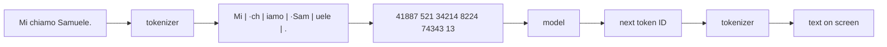

# 4a. Tokens and the tokenizer

A model never reads text. It reads a list of numbers. The **tokenizer** cuts the text
into pieces from a fixed list (the **vocabulary**) and replaces each piece with its
number (the **token ID**). The model answers one number at a time, and the tokenizer
turns the numbers back into text.



Qwen3's vocabulary has **151,669** entries. The tokenizer and its vocabulary are fixed
when the model is trained: a model can only be used with its own tokenizer.

## See it

```bash
docker compose run --rm app python tokens.py "Mi chiamo Samuele."
```

[`tokens.py`](../tokens.py) colours each token and prints the IDs and counts. Ollama
can't show this, so the script loads Qwen3's tokenizer with Hugging Face's `tokenizers`
library (downloaded once into `models/`). Its counts match Ollama's exactly
([experiment 003](experiments/003-what-text-costs.md)).

## Where the vocabulary comes from

Qwen3 uses **byte-level BPE** (byte pair encoding). Roughly:

1. Start from the 256 possible bytes: any text in any language can be written with them,
   so nothing is ever "unknown".
2. In a huge amount of training text, find the pair of neighbouring pieces that appears
   most often, and add it to the vocabulary as a new piece (`t` + `h` → `th`).
3. Repeat until the vocabulary is the chosen size.

The result: **what was frequent in the training text became a single token**. Common
English words are one token each, often with the space in front (`·model`). Rarer
words, names and other languages are built from several pieces (`·ric|orda`).

## What follows from it

From [experiment 003](experiments/003-what-text-costs.md):

| Observation | Example | Why it matters |
|---|---|---|
| Italian costs more than English | same paragraph: 49 vs 37 tokens (+32%) | the window fills sooner, reading takes longer |
| rare names cost more | `·Sam` 1 token, `·Rec\|an\|ati` 3 | relevant for RAG on specific documents |
| typos cost more | `·conversation` 1, `·conv\|res\|ation` 3 | |
| one token per digit | `2026` → 2, 0, 2, 6 | arithmetic is done on pieces, not numbers |
| letters are hidden inside tokens | `·conversation` is one unit | "how many r in…" is hard for a model |
| the space is part of the next word | `Sam` (23950) ≠ `·Sam` (8224) | |

Cloud APIs charge per token, so the same text can cost more in one language than in another.

## Special tokens

Some vocabulary entries are never produced by cutting normal text. They are single
tokens that mark structure:

| Token | Marks |
|---|---|
| `<\|im_start\|>`, `<\|im_end\|>` | start and end of a message (user, assistant, system) |
| `<think>`, `</think>` | the model's reasoning (Qwen3 thinking mode) |
| `<tool_call>`, `</tool_call>` | a tool call (later in the roadmap) |
| `<\|endoftext\|>` | end of the text |

They are why the chat's `read` count is higher than the tokens you typed: the messages
are wrapped in them before reaching the model. That wrapping is the **chat template**
(next concept, 4c).

## Try it

```bash
docker compose run --rm app python tokens.py "the house is big"
docker compose run --rm app python tokens.py "la casa è grande"
docker compose run --rm app python tokens.py "strawberry"
echo 'def add(a, b): return a + b' | docker compose run --rm -T app python tokens.py
```
