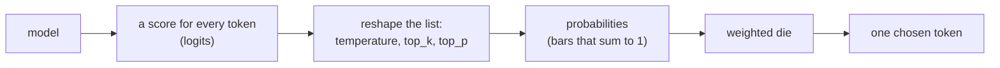

# 4d. Sampling

A model does not pick *the* next word. For each token it scores **every** token in its
vocabulary (~150,000 of them), turns those scores into probabilities, and then **draws
one at random, weighted by its probability**. That draw is called **sampling**, and it
is why the same question can give different answers.



The model's job ends at the scores. Everything after it — the three knobs and the die —
happens **outside** the model, as plain arithmetic on the numbers it produced.

## The list, for one token

Asked "Pick a random number between 1 and 10", `qwen3:1.7b` produced this list for its
first token (top candidates, the long tail left out):

```
'5'   71%  ████████████████████████████
'4'   15%  ██████
'3'    6%  ██
'6'    4%  ██
'7'    3%  █
```

Two things to read from it:

- **The model is not a dice.** A fair draw would give each number 10%. It strongly
  prefers "5", because that is how people write about "random" numbers in its training
  text. It imitates; it does not compute.
- **Variety = how spread out the list is.** Draw from this list and you usually get "5",
  sometimes "4" or "3". Ask for a fruit instead and the list is "Apple" 92%, almost
  nothing else: ten draws give "Apple" ten times. Same die, different spread. This is the
  real answer to "why do answers vary" — only as much as the list is spread.

## The three knobs (they reshape the list before the draw)

### temperature — flatten or sharpen

Every score is divided by the temperature before becoming a probability
(`probability ∝ e^(score / T)`), so:

| temperature | effect | the "5" list becomes |
|---|---|---|
| 0.2 (cold) | gaps grow, top token dominates | "5" → **100%**, rest ~0% |
| 1.0 | the model's natural list | "5" 71% |
| 1.5 (hot) | gaps shrink, list evens out | "5" 53%, "4" 19%, "3" 10%… |

The name is borrowed from physics on purpose. It is the Boltzmann distribution
(`p ∝ e^(-E/kT)`): low temperature freezes a system into its lowest-energy state
(ordered, predictable), high temperature spreads it across many states (disordered,
random). Here the model's score plays the role of energy. "Heating up" the model is the
exact same equation.

### top_k — keep the k best

Keep only the `k` most likely tokens, throw the rest away, rescale what is left.
`top_k = 5` on the list above keeps "5", "4", "3", "6", "7" and drops everything else.
A fixed cut: always `k` tokens, whatever the shape.

### top_p — keep up to p of the mass

Keep the most likely tokens until their probabilities add up to `p`, drop the rest.
`top_p = 0.9` on the fruit list keeps only "Apple" (already 92%), so the answer is
locked in. On a flat list it keeps many tokens. Unlike top_k, it **adapts to how sure the
model is**: few options when confident, many when unsure.

Qwen3's defaults combine them: `temperature 0.6`, `top_k 20`, `top_p 0.95`.

## Greedy vs sampling

Always taking the top token (`temperature 0`) is **greedy decoding**.

| | Greedy (top token) | Sampling (weighted die) |
|---|---|---|
| Same input, same output? | yes — repeatable | no — varies each run |
| Language | flat, can loop ("the the the") | natural, varied |
| Dead ends | can't escape a bad start | a non-top token can find a better path |
| Best for | facts, math, code, tool calls | writing, chat, brainstorming |

This is why we keep temperature low for anything that has one right answer (and will for
the later tool-calling step), and why chat defaults sample: a form-letter assistant is
worse than a slightly surprising one.

## Where the knobs live (and why it matters later)

Sampling settings are **not part of the model**. They are applied per request, after the
weights have spoken, so they can change on every call — even mid-conversation — on any
model, open or closed. That is exactly what the step 6 dashboard will do live.

- They are set in the request's settings (`temperature`, `top_p`…), **not** by typing
  "use temperature 1.5" in the prompt. Prompt text is words the model reads; the settings
  are a control the server enforces. (Same split as the system message: text is a hint,
  the setting is a lever.)
- They cannot add knowledge or remove the model's trained-in rules — they only reshape a
  list the model already made. Safe to expose to users; the worst they do is give
  themselves a worse answer.

## See it

```bash
docker compose run --rm app python sampling.py "Pick a random number between 1 and 10."
```

[`sampling.py`](../sampling.py) pulls the real list from the model, prints the bars,
applies each knob by hand so you watch the list reshape, then rolls the die ten times.
It reshapes only the top ~20 tokens the API returns, not all ~150k, so the percentages
are a hair high; the behaviour is the real thing.

Measured on this laptop: [experiment 006](experiments/006-temperature-spread.md).
