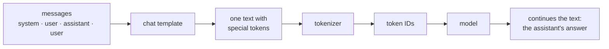

# 4c. Chat templates

A model has no idea what a "message" or a "role" is. It only continues a text. Before
each request, Ollama pastes the list of messages into **one text**, using the model's
**chat template**, and the model continues that text. Its continuation is the answer.



Each model family is trained with its own template: Qwen3 uses `<|im_start|>` and
`<|im_end|>`, other families use other markers. Sending a model text in the wrong
format makes it answer worse.

## See it

```bash
docker compose run --rm app python template.py "My name is Sam."
```

[`template.py`](../template.py) is Qwen3's template written out by hand (without the
tool-calling parts). Special tokens are in yellow, newlines shown as `↵`:

```
<|im_start|>user↵
My name is Sam. /no_think<|im_end|>↵
<|im_start|>assistant↵
<think>↵
↵
</think>↵
↵
```

You typed 5 tokens; the model reads **21**. The original template is inside the model
file: `docker compose exec ollama ollama show --template qwen3:4b-q4_K_M`.

## How it works

| Piece | What it does |
|---|---|
| `<\|im_start\|>user` … `<\|im_end\|>` | wraps each message and says who wrote it |
| system messages | joined into one block at the very top |
| earlier answers | pasted back in as text: this is the model's whole "memory" ([02](02-chat-history.md)) |
| `<\|im_start\|>assistant` at the end | an open turn: the most likely next text is now the assistant's answer |
| `/no_think` or `/think` | appended to your last question: Qwen3's switch for thinking |
| empty `<think>↵↵</think>` | thinking off: an empty reasoning block, written for the model, so it goes straight to the answer |

The model stops when it writes `<|im_end|>` itself: that is how it "knows" its answer
is finished.

## Checked against Ollama

[Experiment 004](experiments/004-chat-template-check.md): for four different chats, the
token count of `template.py`'s text equals the `prompt_tokens` Ollama reports. The
hand-written template is exact.

## What follows from it

- **The wrapping costs tokens on every message** (about 5 per message, plus 6 more with
  thinking off). It is part of the `read` count in the chat's usage line
  ([03](03-tokens-and-context.md)).
- **Roles are just text.** Nothing technical separates "system" from "user": the model
  learned during training to give the system block more weight. This is also why
  prompt injection works: text pasted into a message can imitate instructions.
- **Thinking on/off is a trick in the text**, not a switch in the model.
