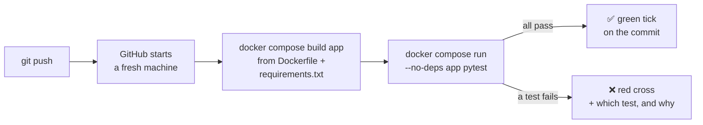

# 5. Tests: checking the code without a model

A **unit test** is a small function that calls our code with a known input and checks
the output. If a later change breaks something (the context bar, the trace format, the
chat template), a test fails and says where, instead of us noticing weeks later.

```bash
docker compose run --rm --no-deps app pytest
```

`--no-deps` stops Compose from starting Ollama: these tests never call a model.

## What is tested, and what isn't

Only **pure** code is tested: data in, result out, no model, no network. That makes the
tests fast (60 tests in ~4 s) and always give the same answer.

| Tests | What they check |
|---|---|
| [`test_config.py`](../tests/test_config.py) | settings from environment variables, and their defaults |
| [`test_stats.py`](../tests/test_stats.py) | speed, the context bar, the 80% warning, the three ways to detect a cut ([03](03-tokens-and-context.md)) |
| [`test_tracing.py`](../tests/test_tracing.py) | the trace format ([traces.md](traces.md)): valid JSON Lines, accents kept, `tokens` only with `/confidence` |
| [`test_template.py`](../tests/test_template.py) | the chat template gives exactly the text Ollama gives ([4c](04c-chat-templates.md), [experiment 004](experiments/004-chat-template-check.md)) |
| [`test_sampling.py`](../tests/test_sampling.py) | softmax, temperature, top-k, top-p ([4d](04d-sampling.md)) |
| [`test_confidence.py`](../tests/test_confidence.py) | the colour scale boundaries and entropy ([4f](04f-confidence.md)) |

**Not tested automatically:** anything that talks to the model (`chat.ask`,
`confidence.ask`, `sampling.candidates`), token counting (downloads the tokenizer) and
`weights.py` (reads the model files). A model's answer changes from run to run, so
"is the answer right?" is a job for the [experiments](experiments/README.md), not for
unit tests.

## On every push: GitHub Actions

GitHub runs the same tests on its own machines after every push
([`.github/workflows/tests.yml`](../.github/workflows/tests.yml)). Its machines have
Docker, so the workflow builds our image and runs pytest inside it: the same
environment as on the laptop, and a check that the image still builds.



The result shows next to each commit on GitHub, under the repository's **Actions** tab.

## Reading a failure

pytest shows the line that failed (`>`) and what each part of it evaluated to (`E`).
A real run, with the 80% warning threshold changed to 90%:

```
    def test_context_warning_only_above_80_percent():
        assert context_warning(turn(3000, wrote=0), 4096) is None   # 73%
>       assert context_warning(turn(3300, wrote=0), 4096) is not None  # 81%
E       assert None is not None
E        +  where None = context_warning(TurnStats(read=3300, wrote=0, first_token_s=0.5, writing_s=2.0), 4096)

tests/test_stats.py:54: AssertionError
FAILED tests/test_stats.py::test_context_warning_only_above_80_percent
```

At 81% full, the warning should appear, but `context_warning` returned `None`.

Then either the code is wrong (fix it) or the rule changed on purpose (fix the test).
