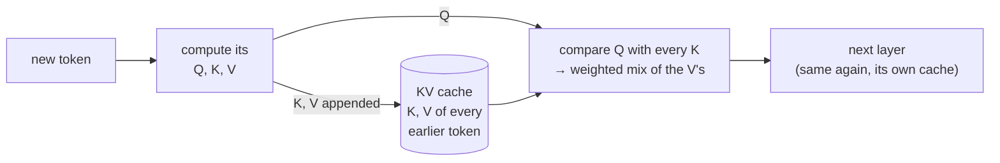
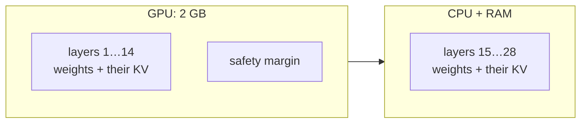

# 4b. KV cache

A model writes **one token at a time**, and each new token has to "look back" at every
token before it (this look-back is called **attention**). The KV cache is the model's
notes on what it has already read, so it doesn't have to read it all again for every
new token.

## The problem it solves

Without a cache, every new token would mean reprocessing the whole conversation:

```
token 501: process tokens 1…500  → pick token 501
token 502: process tokens 1…501  → pick token 502   ← tokens 1…500 again
token 503: process tokens 1…502  → pick token 503   ← and again
```

The work on tokens 1…500 gives the same result every time. Pure waste.

## What is stored: Keys and Values

The model is a stack of **layers** (28 in `qwen3:1.7b`). In every layer, each token is
turned into three short lists of numbers (vectors):

| Vector | Library analogy | Role |
|---|---|---|
| **Q**uery | the question you are asking | "what am I looking for?" (only the *new* token needs it) |
| **K**ey | the label on a book's spine | "this is what I'm about" |
| **V**alue | the book's content | "this is the information I carry" |

The new token compares its Query with every earlier Key ("which books are relevant?"),
then takes a weighted mix of their Values ("read those books").

The key fact: **a token's K and V never change once computed**, because a token only
ever looks backwards. So they are computed once and kept. That store is the KV cache.



## It is many matrices, not one

Each layer, and inside it each **head** (a parallel "reader" looking for different
things), has its own K matrix and V matrix. For `qwen3:1.7b` at context 4096:

```
28 layers × 8 heads × 2 (K and V) = 448 matrices
each: 4096 rows (one per token slot) × 128 numbers
```

The memory for all rows is **reserved up front**; rows fill one by one as tokens arrive.

🔍 Deeper: the model has 16 query heads but only 8 key/value heads; pairs of query
heads share one K/V (*grouped-query attention*). This halves the cache.

## Two phases you can measure

- **Prefill** (reading the prompt): K and V for all prompt tokens are computed in one
  go. This is the **time to first token** shown by `chat.py`.
- **Decode** (writing the answer): one token at a time. Only the new token's Q, K, V
  are computed; everything else is read from the cache. This is why writing speed
  (tokens/s) stays steady instead of slowing down with every token.

Ollama also keeps the cache **between turns**: if the new request starts with the same
history, that part is not prefilled again, so follow-up messages start answering faster.

## Where the memory goes: the formula

```
per token = 2 (K and V) × layers × KV heads × numbers per head × bytes per number

qwen3:1.7b = 2 × 28 × 8 × 128 × 2 bytes (f16) = 114,688 bytes ≈ 112 KiB per token
```

| Context | KV cache (1.7B, f16) | Source |
|---|---|---|
| 256 | 28 MiB | measured, [experiment 002](experiments/002-context-overflow.md) |
| 4096 | 448 MiB | measured, Ollama log in [step 1](01-setup.md) |
| 8192 | 896 MiB | formula |

`K (f16)` and `V (f16)` in the Ollama log mean each number is a 16-bit float: 2 bytes.

## Why it costs memory even when the chat is short

Ollama sizes the cache for the **whole context window**, before the first token, so it
can never run out mid-answer. A 10-token chat and a 4000-token chat use the same
448 MiB.

## Why it pushes layers off the GPU

The MX150 has 2 GB. Ollama places the model **layer by layer**, and each layer brings its
weights **plus its slice of the KV cache**. A bigger cache leaves room for fewer layers on
the GPU; the rest run on the slower CPU.



Experiment 002 showed it: shrinking the context from 4096 to 256 cut the cache 16×,
put 21 layers on the GPU instead of 14, and made writing ~40% faster.

## Is the KV cache the context size?

**In practice, yes: the context size is the number of rows in the KV cache.** Set
`LLM_CONTEXT_SIZE=4096` and Ollama builds a cache with 4096 empty rows. The model can
only "see" what is in the cache, so "the context window" = "what is in the cache now".

One ceiling on top: the model was trained on texts up to a maximum length (32,768
tokens for Qwen3). Past that it degrades into nonsense, so a bigger cache would be
useless.

Attention needs one more piece of memory while reading a prompt: a temporary table of
scores, every token against every other, so it grows with N². **Flash attention**
computes it in small tiles so the full table never sits in memory at once.

## When the cache is full

The cache never grows past the context size. A tiny 8-row cache, full:

```
rows:  1    2    3    4    5     6   7       8
      [My] [na] [me] [is] [Sam] [.] [Write] [a]        ← full, next token: "poem"
```

The server does **not** drop one row per new token. It keeps the first few rows, throws
away the **oldest half** of the rest in one go, and slides the remainder left:

```
      [My] [Sam] [.] [Write] [a] [poem] [ ] [ ]        ← room for several tokens
```

**Why in big cuts?** Each shift has to touch every row that stays (move it and fix its
position). The cost of one shift is about the same either way; what changes is how
often it happens. Writing 2000 tokens with a full 4096-row cache:

| Strategy | Rows touched per shift | Shifts | Total |
|---|---|---|---|
| Drop 1 per new token | ~4095 | 2000 | ~8,000,000 |
| Drop half at once | ~2048 | 1 | ~2,000 |

The price: a big cut forgets more at once.

From the Ollama log in [experiment 002](experiments/002-context-overflow.md):

```
slot context shift, n_keep = 4, n_left = 251, n_discard = 125
```

Kept the first 4 tokens, discarded 125 of the remaining 251 (half). The model is not
told; it simply no longer sees them. That is how "My name is Sam" was lost.

🔍 Deeper: each K vector has its position baked in (that is how the model knows word
order), so after a shift the kept keys are "re-rotated" to their new positions
(*RoPE*).

### Two cuts, two moments

| When | Who cuts | What is cut | What is kept |
|---|---|---|---|
| Before reading (the request is already too long) | Ollama | oldest **whole messages** | system message + latest message (to verify in experiment 007) |
| Mid-answer (cache fills while writing) | llama.cpp, the engine inside Ollama | oldest **half of the tokens** | first 4 tokens only |

In a normal chat the first cut is the common one: every turn sends the full history, and
Ollama trims it before the model reads. So the system message usually survives. The
mid-answer cut needs one answer to overflow the window, which is rarer, and then even
the system message can be lost.

### Why keep the first 4 tokens? Attention sinks

Models put a large share of their attention on the **first few tokens**, whatever they
say: a "parking spot" for attention that has nowhere better to go. Remove them and the
output collapses (found by the *StreamingLLM* paper, 2023). So the first tokens are
kept not for their content, which is just the chat template's opening, but because the
attention math depends on them being there.

## Beyond Ollama: smarter ways to keep the right things

Ollama keeps "the start + the most recent part". Other approaches exist, at three levels:

| Level | Examples | Idea |
|---|---|---|
| Engine: smarter eviction | *H2O*, *SnapKV* (research) | keep the tokens that received the most attention, not just the recent ones |
| Model design: cheaper tokens | grouped-query attention, sliding-window layers, compressed KV (DeepSeek), 8-bit cache | each token costs fewer bytes in the cache |
| App: manage the text | summarise old messages (Claude Code's `/compact`), drop old tool results, retrieval (step 7) | cut or compress *before* the model reads |

Frontier chat apps have contexts of hundreds of thousands of tokens and mostly work at
the app level. What closed models do inside their engines is not public.

## Knobs that shrink the cache

| Knob | Effect | Cost |
|---|---|---|
| Smaller context (`LLM_CONTEXT_SIZE=2048`) | cache ÷ 2 | the model sees less conversation |
| `OLLAMA_KV_CACHE_TYPE=q8_0` | 1 byte per number instead of 2: cache ÷ 2 | tiny quality loss; needs flash attention on |
| `OLLAMA_FLASH_ATTENTION=1` | leaner attention computation | none in theory; support varies by GPU |

Measured on this laptop: experiment 007 (next).
