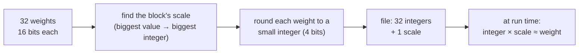
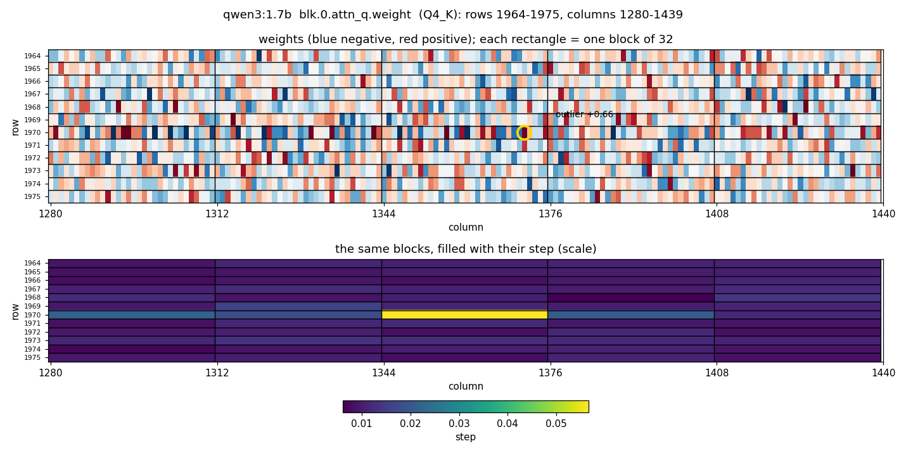
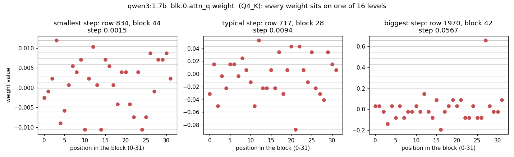
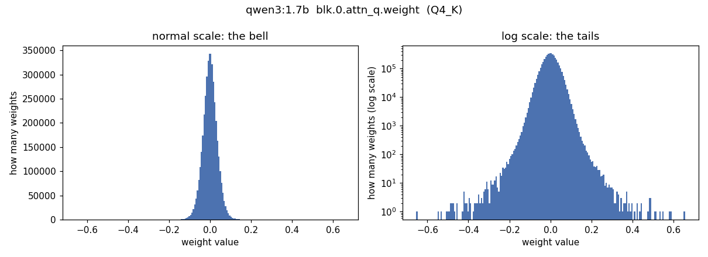
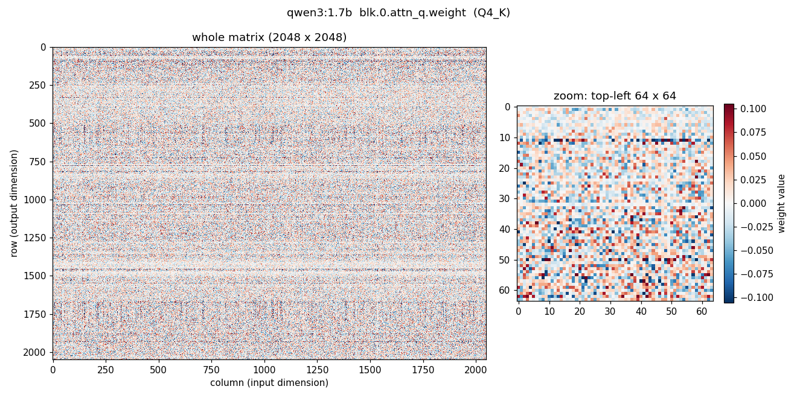

# 4e. Quantization

A model is billions of numbers, its **weights**. They are trained as 16-bit floats
(2 bytes each), so `qwen3:4b` would need about 8 GB. The file you run is 2.5 GB.
**Quantization** is how: store each weight with fewer bits, accepting a small error.



## Blocks and scales

Weights are taken in **blocks** (typically 32). Each block gets one **scale**, and each
weight is stored as a small integer. To use it: `value ≈ integer × scale`.

Example: 4 bits (16 integers, −8 to 7), a block of 4 weights:

```
original:    0.12   -0.31    0.05    0.27
scale = 0.31 / 7 ≈ 0.044                  (the biggest value maps to 7)
stored:        3      -7       1       6   ← 4 bits each instead of 16
recovered:   0.13   -0.31    0.04    0.27  ← small rounding errors
```

Every weight is now slightly wrong. It works because there are billions of them: the
errors are small and mostly cancel out.

**A block is a group of positions, not of values:** 32 weights that sit next to each
other in one row of the matrix. The layout is fixed, so the file only stores the
integers and one scale per block, never "which weight belongs to which block".
(Grouping by value exists, *codebook* quantization, but it needs a label per weight.)

```
one row of a matrix (2048 weights, in order):
[ w0 … w31 ][ w32 … w63 ][ w64 … w95 ] …  [ w2016 … w2047 ]
  block 1     block 2      block 3           block 64
  scale s1    scale s2     scale s3          scale s64
```

The real thing: a 12-row window of the matrix, each block of 32 outlined. Top: the
weights. Bottom: each block filled with its step. One outlier (+0.66, circled) makes its
whole block's grid coarse:



In the real file, every weight of a block sits on one of its 16 levels, and the grids
differ a lot between blocks ([experiment 008](experiments/008-quantization.md)):



## Why each block has its own scale: dynamic range

Weights span a wide range: mostly tiny values, plus a few large **outliers**. One scale
for everything would be set by the largest weight, and every small weight would round
to 0:

```
weights:   0.02   -0.01   0.03   …   2.10  (outlier)
scale = 2.10 / 7 = 0.30
stored:      0       0      0    …     7      ← the small weights are wiped out
```

Inside a small block the range is usually narrow, so a per-block scale spends the few
bits where the values actually are. An outlier only costs precision inside its own
block (the right-hand block above: one weight at 0.66, the other 31 squeezed onto ~5
levels). Like HDR photography: expose each region separately.

Because blocks run along rows, the shape of the outliers matters:

| Outlier | Effect |
|---|---|
| A strong **row** | all its blocks get bigger scales together; inside each block values are similar. Harmless. |
| A strong **column** (one input dimension) | one big value in a block of *every* row: each loses precision for its other 31 weights. Harmful. |

The trade-off: each scale costs bits too. Smaller blocks are more precise but carry more
scales. 32 is the usual compromise.

## What weights look like

Within one matrix, weights form a **bell shape centred on zero**, with heavier tails than
a perfect bell curve. A real one, the first attention matrix of `qwen3:1.7b`
(`python weights.py blk.0.attn_q.weight`):



Typical spread (standard deviation) 0.035; the biggest weight is 0.66, **19× the
spread**. 0.62% of weights are beyond 3× the spread, against 0.27% for a perfect bell
curve: the log-scale panel shows those tails.

The same matrix as an image, one pixel per weight (blue negative, red positive):



Mostly noise, plus **horizontal stripes**: some rows are much stronger or fainter than
others (from 2.3× to 0.25× the typical row). Each row produces one output number, so
the model clearly uses some outputs more than others.

| Property | Why it matters for quantization |
|---|---|
| Centred near zero | positive and negative values roughly balance |
| Most values small | most precision is needed close to zero |
| Heavy tails | a few outliers stretch the range: the dynamic-range problem |
| Each matrix has its own spread | one scale can't fit all of them |

- Training starts from small random values drawn from a bell curve, scaled so signals
  don't blow up across dozens of layers. Training reshapes them, but the bell shape
  largely stays.
- **Outliers are not noise.** A few specific dimensions carry consistently large values
  in every layer; the model uses them for special jobs (linked to the
  [attention sinks](07-kv-cache.md#why-keep-the-first-4-tokens-attention-sinks)).
  Crush them and quality collapses, so good formats protect them.
- Not everything is a bell: normalisation weights (a "volume knob" per dimension) sit
  around 1. They are few, and usually kept at full precision.
- A plain 4-bit grid spaces its 16 levels evenly, so with a bell curve most weights
  crowd into the middle levels. Formats like *NF4* ("normal float") space the levels
  along the bell curve instead: dense near zero, sparse in the tails.

## Reading `Q4_K_M`

| Part | Meaning |
|---|---|
| **Q4** | about 4 bits per weight |
| **K** | "k-quants": blocks of 256 split into 8 sub-blocks of 32, each with its own scale and offset, stored compressed in 6 bits |
| **M** | "medium" mix: the most sensitive matrices are kept at 6 bits (`Q6_K`) or more, the rest at 4 |

A value is rebuilt as `integer × scale + offset`. The offset shifts the range for blocks
not centred on zero.

### Why more than 4 bits

The scales cost bits too. One `Q4_K` block of 256 weights:

```
256 integers × 4 bits                         = 1024 bits
8 sub-blocks × (6-bit scale + 6-bit offset)   =   96 bits
2 numbers for the whole block × 16 bits       =   32 bits
                                        total = 1152 bits ÷ 256 = 4.5 bits per weight
```

Then the "M" mix keeps some matrices bigger. Measured in the real files with
[`weights.py`](../weights.py):

| Model | Q4_K (4.50 bits) | Q6_K (6.56 bits) | F16 (16 bits) | Average | File |
|---|---|---|---|---|---|
| `qwen3:1.7b` | 73% of weights | 24% | 3% | **5.33 bits** | 1.36 GB |
| `qwen3:4b-q4_K_M` | 77% | 21% | 2% | **5.20 bits** | 2.61 GB |

So "Q4" models average over 5 bits. The F16 part is the `attn_v` matrices, kept at full
precision. Small models pay more: in the 1.7B, the output matrix alone (151,936 tokens ×
2048, in `Q6_K`) is 15% of all weights. Bytes = bits ÷ 8: 4.0 billion × 5.20 ÷ 8 =
2.61 GB, the file size.

## Why it also makes the model faster

Writing one token means **reading every weight once**, and on this laptop speed is
limited by how fast memory can be read ([experiment 007](experiments/007-kv-cache-size.md)).
Fewer bytes per weight → less to read → more tokens per second. Quantization saves
memory **and** buys speed, for the same reason.

## What it costs

| Format | Bits per weight | `qwen3:4b` size | Quality |
|---|---|---|---|
| F16 (original) | 16 | ~8 GB | reference |
| Q8_0 | ~8.5 | ~4.3 GB | practically the same |
| **Q4_K_M** | 5.2 (measured) | 2.6 GB | small loss; the usual best trade-off |
| Q2_K | ~3 | ~1.7 GB | noticeably worse: confused answers, broken facts |

Small models suffer more: a 1.7B has less spare capacity to absorb the errors than a 70B.

🔍 Deeper: smarter methods (*imatrix*, *GPTQ*, *AWQ*) measure which weights matter
most on sample text and protect those, so their low-bit versions lose less.

## Static or dynamic?

"Dynamic" means three different things:

| Meaning | What it is | Here |
|---|---|---|
| Per-block scales | each block gets a scale fitted to its values | yes, but computed **once** when the file is made: *block-wise*, not dynamic |
| Mixed bits per matrix | sensitive matrices get more bits | yes, mildly (the "M"); some tools call stronger versions "dynamic quants" |
| Dynamic quantization (textbook) | **activations**, the numbers flowing through the model, are quantized **at run time** with scales computed on the fly | yes: llama.cpp turns activations into 8-bit blocks just before multiplying them with the 4-bit weights, for fast integer maths |

```
weights:      quantized once, offline (Q4_K_M file)        → static
activations:  quantized at run time, per block, to 8 bits → dynamic
KV cache:     quantized at run time as tokens arrive (q8_0) → dynamic
```

Weights are fixed, so they can be done offline. Activations depend on your prompt: their
range is only known while the model runs.

## Two quantizations: weights and KV cache

| | Weights (`Q4_K_M`) | KV cache (`q8_0`, [4b](07-kv-cache.md)) |
|---|---|---|
| What | the model's fixed knowledge | the notes on the current conversation |
| Chosen | when the file is made (in the model's tag) | when the server starts (`.env`) |
| Same trick? | yes: blocks + scales | yes |

## Q4 vs Q8 on this laptop

[Experiment 008](experiments/008-quantization.md), `qwen3:1.7b`:

| | Q4_K_M | Q8_0 |
|---|---|---|
| File | 1.36 GB | 2.22 GB |
| Layers on GPU | 16 / 29 | 9 / 29 |
| Writing speed | ~15.8 tokens/s | ~10.4 tokens/s |
| 12 fact questions | 12 / 12 | 11 / 12 |

Q8 was not visibly better and 1.5× slower. Q4_K_M stays the right choice here.
