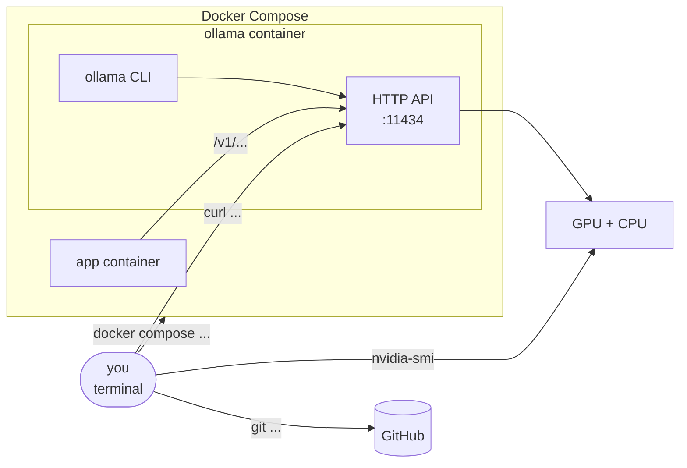

# Cheatsheets

Short, tested commands for each part of the project. Run them from the project folder.

| Cheatsheet | Component | Use it to |
|---|---|---|
| [docker.md](docker.md) | Docker Compose | start/stop containers, read logs, look inside |
| [ollama-cli.md](ollama-cli.md) | `ollama` command | chat by hand, inspect models, see the hidden template |
| [ollama-api.md](ollama-api.md) | HTTP API with `curl` | send the exact requests our Python code will send |
| [gpu.md](gpu.md) | `nvidia-smi` | see what is on the GPU, and how fast it runs |
| [git.md](git.md) | git + GitHub | save and share work |

**Tip:** `curl` replies are JSON. Pipe them into `jq` to make them readable:
`curl -s ... | jq`
