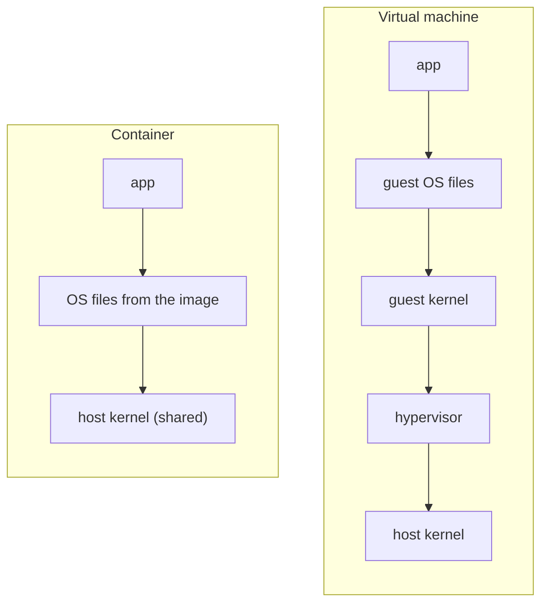
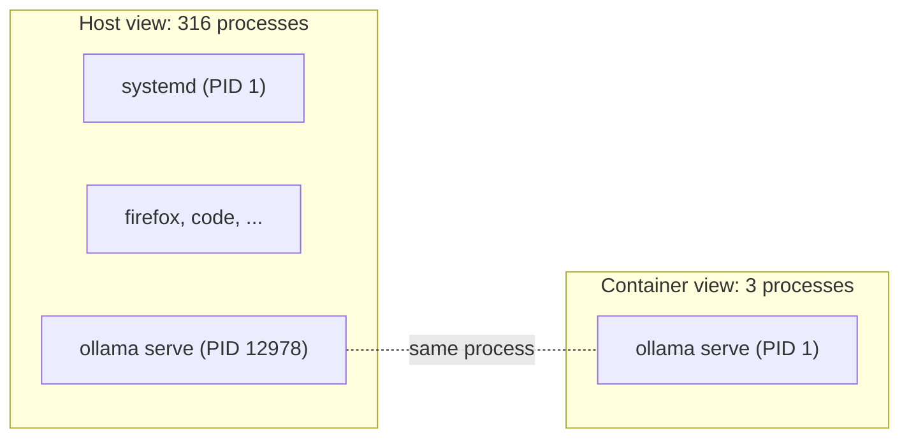

# How containers work

A container is **a normal Linux process that the kernel shows a restricted view of the
computer**. There is no virtual machine. Two kernel features do the work:

- **namespaces** decide what the process can **see**
- **cgroups** decide how much it can **use**

All numbers below were measured on this project's `ollama` container.

## Container vs virtual machine



A virtual machine runs a second kernel on simulated hardware. A container skips both:
its process runs directly on the host kernel. That is why it starts in about a second
and costs almost no extra memory.

The proof, from inside and outside the ollama container:

```
uname -r   host: 6.8.0-138-generic   container: 6.8.0-138-generic
```

Same kernel. (Docker Desktop on Linux is different: it runs containers inside a hidden
virtual machine, which is also why it can't pass the NVIDIA GPU through.)

## Namespaces: what a process can see

The kernel gives the container its own copy of several "views". Each has an id, and the
ids differ between host and container (for example `pid:[4026531836]` vs `pid:[4026533077]`).

| Namespace | Host sees | Container sees | Isolates |
|---|---|---|---|
| PID | `ollama serve` is process 12978, one of 316 | it is process **1**, one of 3 | which processes are visible |
| Mount | Ubuntu 22.04 files | Ubuntu 24.04 files | which files are visible |
| UTS | hostname `x580vn` | hostname `a26310a364dc` (the container id) | machine name |
| Network | `192.168.1.151` (Wi-Fi) | `172.18.0.2` (private Docker network) | network cards, IPs, ports |



Because the container has its own network, a port inside it is invisible from the host
until Docker **publishes** it. That is what `"127.0.0.1:11434:11434"` in
`docker-compose.yml` does.

## Cgroups: how much a process can use

The kernel groups processes and counts (and can limit) their memory and CPU per group.
The ollama process lives in:

```
/system.slice/docker-a26310a364dc....scope
```

| Container | `memory.max` | Meaning |
|---|---|---|
| ollama (ours) | `max` | no limit set |
| `docker run --memory 100m ubuntu` | `104857600` | 100 MB; above it, the kernel stops the process |

`docker stats` reads its numbers from these cgroups.

## "The OS in a container" = every OS file except the kernel

An image is a set of files: programs, libraries, configuration, and the application.

| Part | Example | In the container? |
|---|---|---|
| Kernel | memory, processes, hardware, drivers | no, shared with the host |
| Programs | `ls`, `sh`, `ollama` | yes, its own copies |
| Libraries | glibc, CUDA libraries | yes, its own copies |
| Configuration | `/etc/...` | yes, its own copies |

Same program, different files:

| | Host (Ubuntu 22.04) | Container (Ubuntu 24.04) |
|---|---|---|
| `ls --version` | coreutils 8.32 | coreutils 9.4 |
| glibc (C library) | 2.35 | 2.39 |
| programs in `/usr/bin` | 2177 | 307 |

What makes the ollama image 8 GB:

| Folder | Size | What |
|---|---|---|
| `/usr/lib/ollama` | 4.3 GB | GPU libraries (CUDA 12 and 13, others) |
| rest of `/usr/lib` | 1.3 GB | standard Ubuntu libraries |
| `/usr/bin` | 60 MB | programs, incl. `ollama` (40 MB) |
| `/etc` | 1.3 MB | configuration |

This is the problem containers solve: "works on my machine" usually breaks on
**libraries**, not on the kernel. The container brings its own.

## One thing that is NOT isolated: root

By default, `root` inside a container is the real root of the host kernel. On the host,
`ps` shows `ollama serve` running as `root`. Namespaces hide things, but they don't
lower privileges. This is why:

- being in the `docker` group is effectively root access
- our `app` container runs as your own user (`user: 1000:1000` in `docker-compose.yml`)

## Try it yourself

```bash
# Same questions, inside and outside
docker compose exec ollama sh        # a shell inside; type `exit` to leave
hostname; cat /etc/os-release; ls /proc; uname -r; ls --version | head -1

# The container's main process, seen from the host
docker inspect -f '{{.State.Pid}}' llm_playground-ollama-1
ps -o pid,user,cmd -p <that pid>
cat /proc/<that pid>/cgroup

# A memory limit in action
docker run --rm --memory 100m ubuntu cat /sys/fs/cgroup/memory.max
```

## Open questions

- User namespaces and rootless Docker: making container root not equal host root.
- Image layers: how Docker stores files without copying 8 GB per container.
- System calls: why sharing one kernel is stable enough to work.
