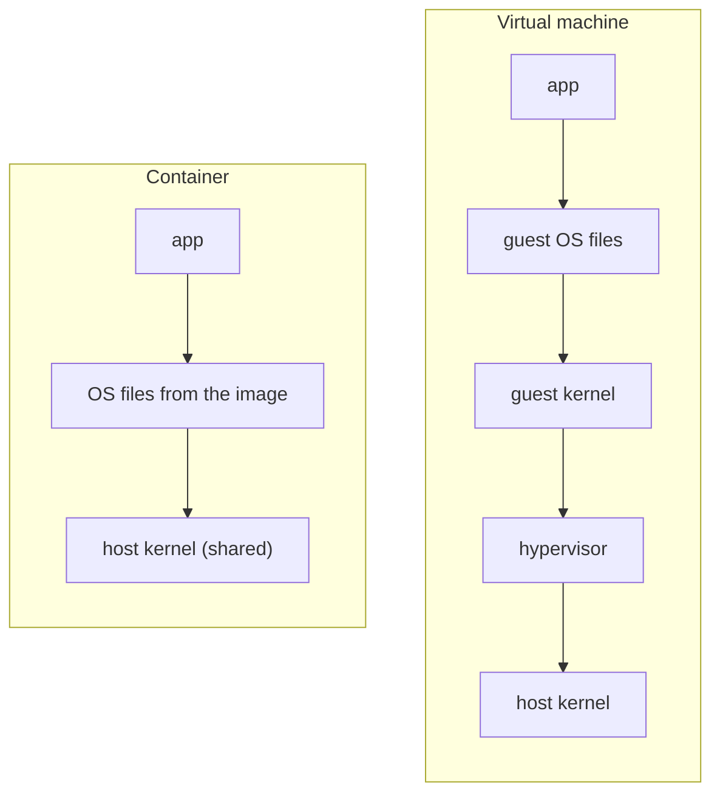
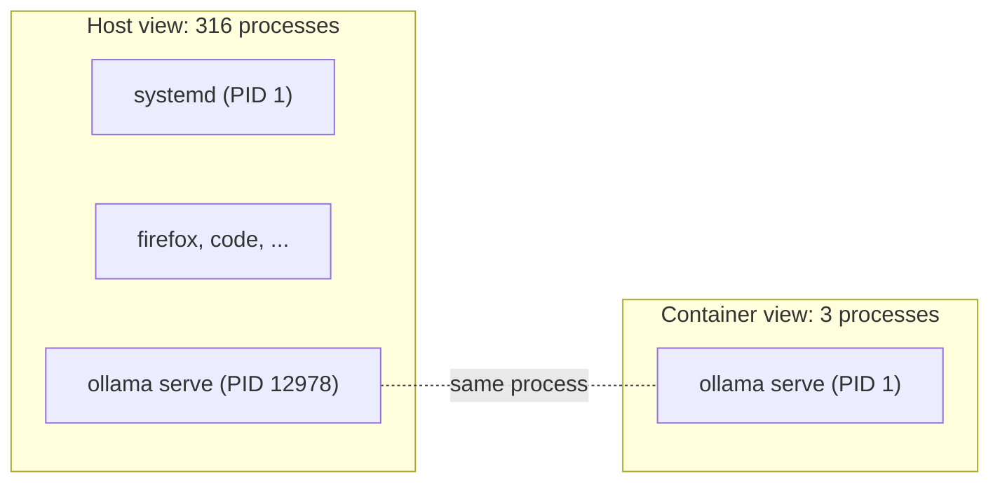
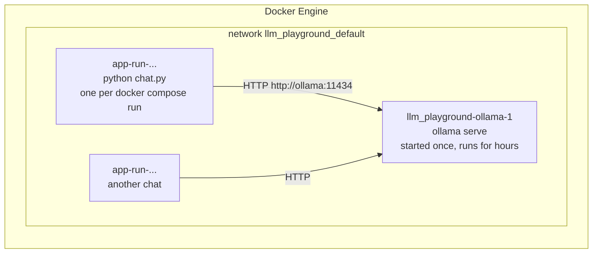
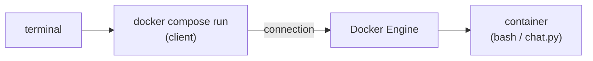

# How containers work

A container is **a normal Linux process that the kernel shows a restricted view of the
computer**. There is no virtual machine. Two kernel features do the work:

- **namespaces** decide what the process can **see**
- **cgroups** decide how much it can **use**

All numbers below were measured on this project's `ollama` container.

## Container vs virtual machine



A virtual machine runs a second kernel on simulated hardware. A container skips both:
its process runs directly on the host kernel. That is why it starts in about a second
and costs almost no extra memory.

The proof, from inside and outside the ollama container:

```
uname -r   host: 6.8.0-138-generic   container: 6.8.0-138-generic
```

Same kernel. (Docker Desktop on Linux is different: it runs containers inside a hidden
virtual machine, which is also why it can't pass the NVIDIA GPU through.)

## Namespaces: what a process can see

The kernel gives the container its own copy of several "views". Each has an id, and the
ids differ between host and container (for example `pid:[4026531836]` vs `pid:[4026533077]`).

| Namespace | Host sees | Container sees | Isolates |
|---|---|---|---|
| PID | `ollama serve` is process 12978, one of 316 | it is process **1**, one of 3 | which processes are visible |
| Mount | Ubuntu 22.04 files | Ubuntu 24.04 files | which files are visible |
| UTS | hostname `x580vn` | hostname `a26310a364dc` (the container id) | machine name |
| Network | `192.168.1.151` (Wi-Fi) | `172.18.0.2` (private Docker network) | network cards, IPs, ports |



Because the container has its own network, a port inside it is invisible from the host
until Docker **publishes** it. That is what `"127.0.0.1:11434:11434"` in
`docker-compose.yml` does.

## Cgroups: how much a process can use

The kernel groups processes and counts (and can limit) their memory and CPU per group.
The ollama process lives in:

```
/system.slice/docker-a26310a364dc....scope
```

| Container | `memory.max` | Meaning |
|---|---|---|
| ollama (ours) | `max` | no limit set |
| `docker run --memory 100m ubuntu` | `104857600` | 100 MB; above it, the kernel stops the process |

`docker stats` reads its numbers from these cgroups.

## "The OS in a container" = every OS file except the kernel

An image is a set of files: programs, libraries, configuration, and the application.

| Part | Example | In the container? |
|---|---|---|
| Kernel | memory, processes, hardware, drivers | no, shared with the host |
| Programs | `ls`, `sh`, `ollama` | yes, its own copies |
| Libraries | glibc, CUDA libraries | yes, its own copies |
| Configuration | `/etc/...` | yes, its own copies |

Same program, different files:

| | Host (Ubuntu 22.04) | Container (Ubuntu 24.04) |
|---|---|---|
| `ls --version` | coreutils 8.32 | coreutils 9.4 |
| glibc (C library) | 2.35 | 2.39 |
| programs in `/usr/bin` | 2177 | 307 |

What makes the ollama image 8 GB:

| Folder | Size | What |
|---|---|---|
| `/usr/lib/ollama` | 4.3 GB | GPU libraries (CUDA 12 and 13, others) |
| rest of `/usr/lib` | 1.3 GB | standard Ubuntu libraries |
| `/usr/bin` | 60 MB | programs, incl. `ollama` (40 MB) |
| `/etc` | 1.3 MB | configuration |

This is the problem containers solve: "works on my machine" usually breaks on
**libraries**, not on the kernel. The container brings its own.

## One thing that is NOT isolated: root

By default, `root` inside a container is the real root of the host kernel. On the host,
`ps` shows `ollama serve` running as `root`. Namespaces hide things, but they don't
lower privileges. This is why:

- being in the `docker` group is effectively root access
- our `app` container runs as your own user (`user: 1000:1000` in `docker-compose.yml`)

## Engine, clients and Compose

Docker is a server plus clients, like Ollama:

| Part | What it is |
|---|---|
| **Docker Engine** (`dockerd`) | a background service started at boot. It creates, runs and owns every container |
| **`docker`** | a client: sends requests to the Engine through `/var/run/docker.sock` |
| **`docker compose`** | a translator on top: reads `docker-compose.yml` + `.env` in the current folder, turns service names into containers, and labels them |

The Engine knows nothing about folders or Compose files. Compose recognises "its"
containers by the labels it sticks on them:

```
com.docker.compose.project = llm_playground
com.docker.compose.service = ollama
com.docker.compose.project.working_dir = /home/samuponz/Documents/Projects/LLM_playground
```

## A project is several containers, side by side

Compose runs one container per job, next to each other (not inside each other), on a
private network it creates for the project:



| | `ollama` | `app` |
|---|---|---|
| Created by | `docker compose up -d ollama`, once | each `docker compose run --rm app` creates a new one |
| Lives | hours or days (`restart: unless-stopped`) | as long as the chat session |
| Role | server: loads models, answers requests | client: sends requests |

- **`depends_on: ollama`** means "make sure ollama is running before starting app": start
  order, not nesting. `run` checks it (`✔ Container llm_playground-ollama-1 Running`)
  and creates only the app container.
- **Service names are hostnames** on the project network: the app reaches the server at
  `http://ollama:11434`. Inside a container, `localhost` is that container itself.

### One job per container

Each container is built around one **main process** (PID 1): `ollama serve`, or
`python chat.py`. The container lives exactly as long as that process: when the chat
exits, its container stops.

A container can still hold several processes: `ollama serve` starts llama.cpp "runner"
helpers to do the maths, and a shell in the app container can start `python chat.py`.
One job, possibly several processes.

| Why one job per container | In this project |
|---|---|
| each part has only the files it needs | CUDA libraries in ollama; Python and `openai` in app |
| parts start, stop and update independently | chats come and go; the server keeps running |
| a crash stays contained | a bug in `chat.py` doesn't touch the server |
| easy to scale | five terminals = five chat containers, one server |

### Without Docker

The same roles exist without containers, installed directly on the system:

| Part | Without Docker | With Docker |
|---|---|---|
| model server | a background program: a **systemd service** on Linux (`ollama.service`), a background tray app on Windows | the `ollama` container |
| chat | a normal program run in a terminal (`python chat.py`) | an `app` container per run |
| Docker itself | | `docker.service`, a background service |

Windows calls background programs *services*; Linux calls them *daemons*, managed by
systemd. Docker keeps the roles and isolates each one, with its own files.

## A container belongs to the Engine, not to your terminal

`docker compose run app` asks the Engine for a container, then **connects your keyboard
and screen to it**. Tested: closing the terminal kills only that client; the container
keeps running, idle, as an orphan.



| Event | Client | Container |
|---|---|---|
| `/bye`, `exit`, Ctrl+D | ends | its program ends, so it **stops**; `--rm` then deletes it |
| terminal window closed | killed | **keeps running** |
| `docker stop <name>` | | stops; `--rm` deletes it |

`--rm` sets `AutoRemove: true` on the container: the Engine deletes it once it has
stopped, however it stopped. It never stops anything by itself.

## Containers are disposable

A container starts from the image every time. Anything changed inside it disappears
when it is removed: a tool installed with `apt-get`, a file written outside `/app`.
What survives:

| Survives | Example in this project |
|---|---|
| the **image** (built from the Dockerfile) | Python + the `openai` package |
| **mounted folders** | the project folder at `/app`: an edit inside is an edit on the laptop |
| **volumes** | `ollama_models`: downloaded models survive `down` and rebuilds |

So everything a container needs belongs in the Dockerfile, a mount or a volume.

## What a program inside sees

A program doesn't know it is in a container: it asks the kernel (through system calls)
and the kernel answers according to its namespaces. Python's `os` module in the app
container vs on the host:

| Question | Container | Host | Why |
|---|---|---|---|
| `os.getpid()` | 1 | 87200 | PID namespace |
| `socket.gethostname()` | `6a1433331c2f` | `x580vn` | UTS namespace |
| `os.uname().release` | 6.8.0-138-generic | 6.8.0-138-generic | shared kernel |
| `os.getuid()` | 1000 | 1000 | `user: 1000:1000` in `docker-compose.yml` |
| `os.listdir("/")` | `.dockerenv`, `app`, `bin`, ... | the laptop's disk | mount namespace |
| `os.environ["LLM_MODEL"]` | `qwen3:4b-q4_K_M` | not set | handed over by Docker at start |

**Environment variables** are name=value pairs a process receives when it starts.
Compose fills the blanks in `docker-compose.yml` from `.env` and starts the container
with them; Python reads them with `os.environ`. Python never reads `.env` itself.

```
chat.py          the messages list
openai package   builds HTTP requests
Python + os      asks the OS for things
  ── system calls ──
Linux kernel     answers through namespaces (what you see) and cgroups (how much)
hardware         CPU, RAM, GPU
```

## ENTRYPOINT and CMD

An image defines how it starts: a fixed **ENTRYPOINT** and a replaceable **CMD**.

| Image | ENTRYPOINT | CMD |
|---|---|---|
| `ollama/ollama` | `/bin/ollama` | `serve` |
| our `app` | none | `python chat.py` |

Arguments after the service name replace CMD. So `docker compose run app bash` gives a
shell, while `docker compose run ollama python ...` runs `/bin/ollama python ...` and
fails. The ollama image is "the ollama program"; ours is "a Python box that defaults to
the chat". `exec` skips the ENTRYPOINT.

Images contain only what their makers put in: the ollama image (Ubuntu) has `top`;
`python:3.12-slim` (Debian) has no `top`, `ps` or `man`, to stay small.

## Try it yourself

```bash
# Same questions, inside and outside
docker compose exec ollama sh        # a shell inside; type `exit` to leave
hostname; cat /etc/os-release; ls /proc; uname -r; ls --version | head -1

# The container's main process, seen from the host
docker inspect -f '{{.State.Pid}}' llm_playground-ollama-1
ps -o pid,user,cmd -p <that pid>
cat /proc/<that pid>/cgroup

# A memory limit in action
docker run --rm --memory 100m ubuntu cat /sys/fs/cgroup/memory.max

# What Python sees from inside
docker compose run --rm app python -c "import os, socket; print(os.getpid(), socket.gethostname(), os.uname().release)"

# Compose's labels on a container
docker inspect llm_playground-ollama-1 --format '{{json .Config.Labels}}' | jq

# Make an orphan: open a shell, close the window, then
docker ps
```

## Open questions

- User namespaces and rootless Docker: making container root not equal host root.
- Image layers: how Docker stores files without copying 8 GB per container.
- System calls: why sharing one kernel is stable enough to work.
