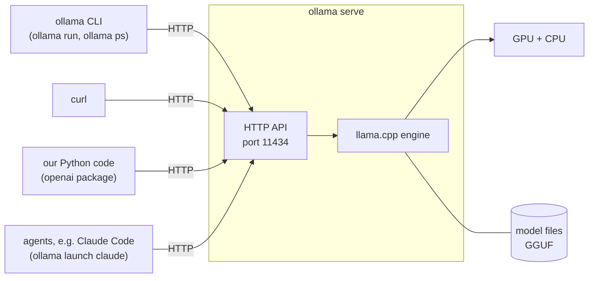
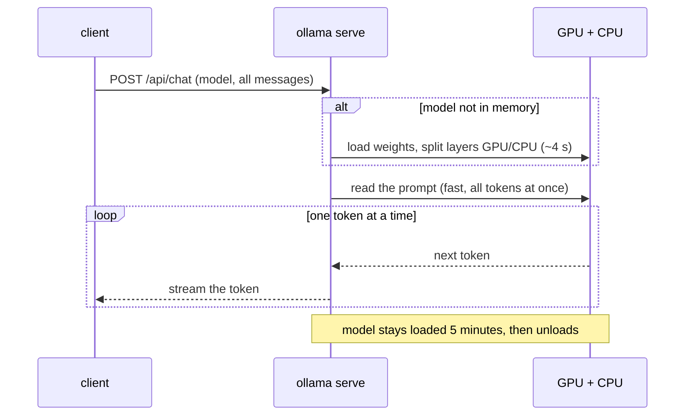

# How Ollama works

Ollama runs language models on your own computer and serves them over HTTP. It is
**a server plus clients**, like Docker. All numbers below were measured in this project
(Ollama 0.40.11, MX150 GPU with 2 GB).

## A server, and clients that talk to it

Only one part actually runs models: the server, `ollama serve` (PID 1 in our container).
Everything else, including the `ollama` command, is a client that sends it HTTP requests.



Proof: one `ollama run qwen3:1.7b "Say hi in 3 words"` produced these lines in the server log:

```
HEAD  "/"              ← is the server there?
POST  "/api/show"      ← tell me about this model
POST  "/api/generate"  ← here is the prompt, give me the answer
```

The same design as Docker: the `docker` command is a client of `dockerd`, through
`/var/run/docker.sock`.

**The server remembers nothing between requests.** In an interactive `ollama run`
session, the *CLI* keeps the conversation and resends all of it with every message.
Close the CLI and the conversation is gone.

## What is inside

| Part | What it is | In our setup |
|---|---|---|
| **llama.cpp** | the open-source engine that does the maths. Ollama is the friendly layer around it. | `RUNNER llamacpp` in `ollama ps` |
| **GGUF files** | llama.cpp's model format: the weights plus metadata in one file | the big files in `/root/.ollama/models/blobs` start with the bytes `GGUF` |
| **Quantization** | weights stored with fewer bits (e.g. `Q4_K_M` ≈ 4–5 bits instead of 16), so models are ~4x smaller and faster, at a small cost in quality | all our models are `Q4_K_M` |
| **Model library** | ollama.com/library: models with names and tags, downloaded with `ollama pull` | `qwen3:1.7b`, `qwen3:4b-q4_K_M` |
| **Manifest** | what a tag points to: a list of layers, in Docker's image format | see below |

The manifest of `qwen3:1.7b`: a model is a bundle of layers, like a Docker image.

| Layer | Size | What |
|---|---|---|
| model | 1.36 GB | the weights (GGUF) |
| template | 1.7 KB | the chat template: how messages become one text |
| params | 120 bytes | default settings (temperature 0.6, top_k 20, top_p 0.95, stop words) |
| license | 11 KB | Apache 2.0 |

## The life of a request



| Measured | Value | Why |
|---|---|---|
| First request after a pause | 4.15 s | the model is loaded from disk first |
| Same request, model already loaded | 0.29 s | |
| Reading the prompt (qwen3:1.7b) | ~74 tokens/s | all prompt tokens are processed together |
| Writing the answer (qwen3:1.7b) | ~16 tokens/s | one token at a time |
| Layers on the GPU (qwen3:1.7b / 4b) | 14 of 29 / 7 of 37 | 2 GB of VRAM minus Ollama's 457 MiB safety margin |

## Three API dialects

The server speaks three formats, so tools written for other services can use it.

| Endpoint | Format of | Used by |
|---|---|---|
| `/api/generate`, `/api/chat`, ... | Ollama's own | the `ollama` CLI; has extras (timings, raw mode, `think`) |
| `/v1/chat/completions` | OpenAI | our Python code: the same code works with any OpenAI-compatible server |
| `/v1/messages` | Anthropic | Claude Code via `ollama launch claude` (Claude Code's program, a different model) |

Same question, three formats: see [the API cheatsheet](../cheatsheets/ollama-api.md).

## Local vs cloud

Besides local models, Ollama offers **cloud models**: big open-weight models running on
Ollama's servers, through the same commands and API.

| | Local (our setup) | Ollama Cloud |
|---|---|---|
| Runs on | your GPU/CPU | Ollama's servers, mainly in the US |
| Model size | what fits in your memory | very large models (hundreds of GB) |
| Cost | electricity | free tier, then plans from $20/month, billed per token |
| Privacy | data never leaves the machine | a promise: "never logged or trained on" |
| Works offline | yes | no |

This project is local only: `OLLAMA_NO_CLOUD: "true"` in `docker-compose.yml`.

## Security: Ollama has no password

Anyone who can reach port 11434 can run models on your hardware, and download or
delete them. The only protection is **who can reach the port**.

| Listening on | Who can connect |
|---|---|
| `127.0.0.1` | only programs on the same machine |
| `0.0.0.0` | anyone who can reach the machine: local network, possibly the internet |

In January 2026, researchers (SentinelOne and Censys) found about 175,000 Ollama servers
open to the internet, with criminals reselling access to them.

Our setup:

- Inside the container Ollama listens on `0.0.0.0`, the container's own private network.
  This is needed so the `app` container can reach it.
- On the laptop the port is published as `127.0.0.1:11434:11434`: only this machine.
  Checked: from the laptop's Wi-Fi address the connection is refused.
- **Docker trap:** a port published as `"11434:11434"` (no `127.0.0.1:`) is reachable from
  the network **even with the ufw firewall on**, because Docker's rules come first.

## Other tools that do the same job

| Tool | What it is | Best for |
|---|---|---|
| llama.cpp | the engine itself | full control, any hardware |
| **Ollama** | engine + model library + API server + model management | developers, simple setup |
| LM Studio | desktop app with a graphical interface | trying models without a terminal |
| Jan, GPT4All | open-source desktop chat apps | a private ChatGPT-like app |
| vLLM, SGLang | high-performance servers | many users on big GPUs |
| llamafile | model + engine in one runnable file | sharing a model as a single file |
| MLX | Apple's framework | Macs with Apple chips |
| Docker Model Runner | Docker's own model runner | people already all-in on Docker |

## Try it yourself

```bash
# Watch the server while a client talks to it (two terminals).
# Terminal 1: leave this running; it prints only NEW requests (Ctrl+C to stop)
docker compose logs -f --tail 0 ollama | grep GIN
# Terminal 2: send a request, then look at terminal 1
docker compose exec ollama ollama run qwen3:1.7b "Say hi"

# Run each command below on its own, one at a time

# The model files and a manifest
docker compose exec ollama sh -c 'cd /root/.ollama/models/blobs && ls -lS | head -4 && head -c 4 $(ls -S | head -1); echo'
docker compose exec ollama cat /root/.ollama/models/manifests/registry.ollama.ai/library/qwen3/1.7b | jq

# Load time vs loaded: run twice, compare total_duration (nanoseconds)
curl -s 127.0.0.1:11434/api/generate -d '{"model":"qwen3:1.7b","prompt":"hi","think":false,"stream":false}' | jq '.total_duration, .load_duration'

# Is the port reachable from the network? (should be refused)
curl -m 3 http://$(hostname -I | cut -d' ' -f1):11434/
```

## Open questions

- Quantization in depth: what `Q4_K_M` means, and how much quality it costs.
- The chat template: how a list of messages becomes one text with special tokens.
- KV cache and context size (see [to-explore.md](../to-explore.md)).
