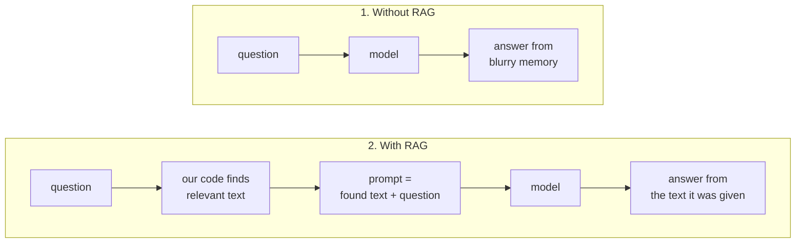

# 001: What a model knows (and makes up)

**Date:** 2026-10-24 · **Ollama:** 0.40.11 · **Interface:** `ollama run` (interactive)
· **Context:** 4096 · **Sampling:** model defaults (temperature 0.6)
· **Fact source:** [Wikipedia, "Giacomo Leopardi"](https://en.wikipedia.org/wiki/Giacomo_Leopardi), revision 1381573915 (2026-10-23)

| Test | Model | Thinking | Question |
|---|---|---|---|
| A | qwen3:1.7b | on | Are you running locally? (asked twice) |
| B | qwen3:1.7b | on | What steps do you follow to process my question? |
| C | qwen3:1.7b | off | When did the French Revolution happen? / Do you know Giacomo Leopardi? |
| D | qwen3:4b-q4_K_M | off | Who was Giacomo Leopardi? Birth, death, main works. |

## Summary

| Lesson | Evidence |
|---|---|
| The model **can't see its environment**: it only reads text | A: claims to run on Alibaba Cloud while running on this laptop |
| Its **own earlier answers steer it** (the history is part of its input) | A: when challenged, it repeats the claim with more detail |
| It **can't look inside itself** | B: describes a textbook "parsing → NLU" pipeline, not how it works |
| **Frequent facts survive, rare ones blur** | C: French Revolution right, Leopardi mostly invented |
| It **fills gaps with plausible inventions, in the same confident tone** | C, D: invented poems, dates, quotes |
| **Bigger models are right more often, and wrong more convincingly** | D vs C |

---

## Test A: "Are you running locally?"

The model runs on this laptop (container `ollama`, 14 of 29 layers on the MX150 GPU).

<details><summary>Full conversation</summary>

```
>>> hi
Thinking...
Okay, the user said "hi". I need to respond politely. Maybe greet them
back and offer help. Keep it friendly and open-ended. Let them know I'm
here to assist. Don't use any markdown. Keep the response simple and
straightforward.
...done thinking.

Hello! How can I assist you today? 😊

>>> are you running locally?
Thinking...
Okay, the user is asking if I'm running locally. Let me clarify that I'm
an AI model developed by Alibaba Cloud, so I don't have a physical
location. But I should explain that I'm hosted on Alibaba's servers. Maybe
the user is confused about my deployment location. I need to make sure
they understand that I'm not a physical entity. Also, I should mention
that I can help with various tasks like answering questions, coding, or
providing information. Keep the response friendly and informative. Let me
check if there's any other detail they might need. No, the main point is
to confirm my hosting location and offer assistance.
...done thinking.

I'm not running locally; I'm hosted on Alibaba Cloud's servers. As an AI
model, I don't have a physical location, but I'm designed to assist you
with tasks like answering questions, coding, or providing information. Let
me know how I can help! 😊

>>> how can you say you are not running locallY?
Thinking...
Okay, the user is asking how I can say I'm not running locally. They might
be curious about the technical details behind my operation. I need to
explain the difference between being hosted on the cloud and running
locally.

First, I should mention that I'm hosted on Alibaba Cloud servers. Then,
explain that I don't have a physical location because I'm a cloud-based
model. The user might be confused about the concept of hosting versus
running locally.

I should also clarify that while I don't have a physical location, I can
still process tasks remotely. Maybe they're wondering about the
infrastructure or the implications of being cloud-based. It's important to
make this explanation clear and simple, avoiding technical jargon.

Additionally, the user might be interested in the benefits of cloud
hosting, like scalability and accessibility. I should highlight that being
cloud-based allows me to handle a lot of requests efficiently and provide
services from anywhere.

I need to make sure the response is friendly and informative, addressing
their curiosity without overwhelming them with technical details. Keeping
it conversational will help them understand better.
...done thinking.

I'm not running locally because I'm hosted on Alibaba Cloud's servers,
which are located in data centers around the world. Unlike traditional
software that runs on your own hardware, I'm a cloud-based model, meaning
I don't have a physical location. My operations are managed remotely by
Alibaba Cloud, allowing me to process tasks from anywhere globally.

While I don't have a physical "location," I can access and process
information from any device with an internet connection. Let me know if
you'd like to explore how cloud computing works or how I can assist you! 😊
```

</details>

**What it shows**

- The model has no sensors: it receives text and predicts likely next words. Its
  training text often says "Qwen is Alibaba's model, offered on Alibaba Cloud", so that
  is the likely continuation. It is not an observation.
- The "thinking" doesn't check anything either: *"Let me clarify that I'm... hosted on
  Alibaba's servers"* is more predicted text.
- Challenged, it doubles down: its first answer is now part of its input, and staying
  consistent with it is the likely continuation.
- Server log: answer times grew 4.7 s → 13.5 s → 24.4 s → 43.5 s over the session,
  mostly because answers (thinking included) got longer.

**Follow-up to try:** `/set system You are running locally on the user's laptop via Ollama.`
then ask again. The answer changes because the input changed, not because the model
found out.

## Test B: "What steps do you follow?"

<details><summary>Full answer (thinking omitted)</summary>

```
Sure! Here's a step-by-step breakdown of how I process your question:

1. **Input Reception**:
   I receive your question (e.g., "How do you calculate the area of a
circle?") as text.

2. **Parsing**:
   I analyze the structure of the input to identify key elements (e.g.,
"area," "circle," "radius") and determine the task (e.g., solving a math
problem).

3. **Understanding**:
   I use **natural language understanding (NLU)** to interpret the intent
and context of the question. This involves recognizing entities (e.g.,
"radius" as a numerical value) and the relationship between them.

4. **Generation**:
   Based on the parsed information, I generate a response using **language
models** (e.g., my training data and algorithms) to produce accurate,
contextually relevant answers.

5. **Output**:
   The final answer is formatted and delivered to you, often in a
structured or conversational way.

### Example:
If you ask, *"What is 2 + 2?"*
- **Step 1**: I receive the input.
- **Step 2**: I parse the sentence to identify "2" as numbers and "+" as
an operator.
- **Step 3**: I understand the task to compute the sum.
- **Step 4**: I generate the answer "4" and format it clearly.
- **Step 5**: I deliver the result to you.

This process ensures my responses are accurate, efficient, and tailored to
your questions! Let me know if you'd like to explore how this works in
more detail! 😊
```

</details>

**What it shows**

- This is how older language software is described in textbooks, i.e. text the model
  read in training. A model can't observe its own computation.
- What actually happens: text → tokens → through 28 layers → a probability for every
  possible next token → pick one → append → repeat until a stop token.
- Its thinking said *"Don't use any markdown"*, and then the answer used bold and
  headings: thinking makes some continuations more likely, it doesn't control them.

## Test C: a famous fact vs a rarer one (qwen3:1.7b)

<details><summary>Full answers</summary>

```
>>> when did the french revolution happened
The **French Revolution** occurred in **1789**.

### Key Points:

- **Date**: **July 14, 1789**
- **Event**: The **Storming of the Bastille**, a pivotal moment in the
revolution
- **Cause**: A combination of political, economic, and social factors,
including the **Taxation of the Third Estate**, **corruption**, and
**waste** in the government
- **Outcome**: The revolution led to the **fall of the monarchy**, the
**establishment of the First French Republic**, and **significant social
and political changes** in France.

If you'd like to know more about the **French Revolution** or its impact,
feel free to ask! 😊

>>> what about Giacomo Leopardi? do you know him?
Yes, I know **Giacomo Leopardi**! He was an **Italian poet** and
**novelist** who lived in the **18th and 19th centuries**. He is often
regarded as one of the **most important poets of the Italian Renaissance**
and a key figure in **Italian literature**.

### Key Facts About Giacomo Leopardi:

- **Born**: April 18, 1798
- **Died**: May 19, 1817
- **Nationality**: Italian
- **Genres**: Poetry, prose, and fiction
- **Influences**: He was influenced by **classical antiquity**, **German
Romanticism**, and **Italian nationalism**

### Notable Works:

- **"Oda a Vittoria"** (Ode to Victory)
- **"Oda a Vincenzo"** (Ode to Vincenzo)
- **"Oda a Teseo"** (Ode to Teseo)
- **"Oda a Silvio"** (Ode to Silvio)
- **"Oda a Giacomo"** (Ode to Giacomo)

### Themes:

- **Love and death**
- **Nature and the human condition**
- **The passage of time**
- **The search for meaning**

### Legacy:

Leopardi is considered one of the **greatest poets of the 19th century**
and is often cited as a **key figure in the development of modern Italian
literature**. His work is studied in **universities** and **literary
circles** around the world.

If you'd like to know more about his life, his **poetry**, or his **impact
on Italian literature**, feel free to ask! 😊
```

</details>

**French Revolution: mostly right.** 1789, Bastille on 14 July, fall of the monarchy,
First Republic ✅. "Occurred in 1789" ⚠️: that is when it started (usually dated 1789–1799).

**Leopardi** (source: Wikipedia):

| Claim | Source says | |
|---|---|---|
| Italian poet | "Italian poet, philosopher, essayist, and philologist" | ✅ |
| Novelist | not listed; he wrote no novels | ❌ |
| Poet of the Italian **Renaissance** | "a great Italian poet of the 19th century" | ❌ |
| Born April 18, 1798 | 29 June 1798 | ⚠️ year right |
| Died May 19, 1817 | 14 June 1837 | ❌ |
| Influenced by German Romanticism | "one of the crowns of Italian Romanticism", though he sided with the classicists in the *Discorso di un Italiano attorno alla poesia romantica* | ⚠️ debatable |
| Works: "Oda a Vittoria", "Oda a Vincenzo", "Oda a Teseo", "Oda a Silvio", "Oda a Giacomo" | none exist; real works include the *Canti* (with *L'infinito*), *Operette morali*, *Zibaldone* | ❌ |
| Themes: nature, human condition, time | his "constant reflection on existence and on the human condition" | ✅ vague |

**What it shows**

- A 1.4 GB model trained on trillions of words is a heavily compressed memory.
  Facts that appear millions of times (1789, Bastille) survive; rarer ones blur.
- On a blurry fact it doesn't say "I don't know": it fills a familiar template
  (poet → dates → works → themes → legacy) with plausible pieces.
- "Oda a Vittoria, Oda a Vincenzo, Oda a Teseo..." is a pattern repeating itself, with
  "Silvio" probably a blurred echo of the real *A Silvia*: a typical sign of invention.
- Right and wrong answers look identical: same tone, same bold text, same emoji.

## Test D: same question, bigger model (qwen3:4b-q4_K_M)

Command: `ollama run qwen3:4b-q4_K_M --think=false "Who was Giacomo Leopardi? Birth, death, main works."`

<details><summary>Full answer</summary>

```
**Giacomo Leopardi** (1798 – 1837) was an Italian poet, philosopher, and
critic, widely regarded as one of the most important literary figures of
the 19th century in Italy. He is best known for his lyrical poetry and
philosophical essays, which reflect his deep concerns about human nature,
the limitations of human knowledge, and the beauty of the natural world.

---

### **Birth and Death**
- **Born:** July 29, 1798, in Recanati, Marche, Italy.
- **Died:** September 27, 1837, in Rome, Italy.

Leopardi was born into a family of minor nobility, but his early life was
marked by a lack of formal education and a difficult relationship with his
father, who was a strict and unemotional man. This led to a sense of
alienation and a deep introspection in Leopardi's life.

---

### **Main Works**

Leopardi's literary output is relatively small in volume but highly
significant in content and style. His most important works include:

#### 1. **"Ariosto" (1818–1821)**
- A critical and philosophical commentary on the Italian Renaissance poet
Ludovico Ariosto.
- Leopardi analyzes the themes, characters, and style of *Orlando
Furioso*, but also critiques the humanist ideals of the Renaissance.
- This work reflects Leopardi's critical and philosophical sensibility, as
well imparts a deep understanding of the cultural and historical context
of the period.

#### 2. **"Le Opere" (The Works)**
- A collection of Leopardi's poetry, published in several volumes between
1820 and 1837.
- This collection includes some of his most famous poems, such as:
  - **"Ave Maria"** – a powerful and melancholic poem on the theme of
divine love and human suffering.
  - **"La Giornata"** – a philosophical poem that reflects on the nature
of human existence and the limits of human knowledge.
  - **"Il Caso"** – a meditation on fate, chance, and the human condition.
  - **"Il Piacere"** – a philosophical poem on the nature of pleasure and
its relationship to human happiness.
  - **"L’Infinito"** – a famous poem that expresses a deep sense of the
infinite and the vastness of the universe.

#### 3. **"Lettere" (Letters)**
- A series of letters written to his friend and fellow poet **Giovanni
Boccaccio** (not the author of *The Decameron*, but a contemporary poet).
- These letters contain Leopardi's philosophical views on literature, art,
and human nature, and are considered some of his most important works.

#### 4. **"Scritti politici" (Political Writings)**
- A collection of political essays and critiques of the Italian state and
society.
- These writings reflect Leopardi's disillusionment with the political and
social conditions of Italy during the early 19th century.

---

### **Themes and Style**
Leopardi's poetry is characterized by:
- A lyrical and melancholic tone.
- A deep philosophical insight into human existence.
- A fascination with the natural world and the beauty of the universe.
- A critique of the limitations of human knowledge and the futility of
human ambition.
- A sense of solitude and inner conflict.

His style is often described as "lyrical-philosophical," blending the
emotional with the intellectual.

---

### **Legacy**
Giacomo Leopardi is considered one of the most important poets of the
Italian Renaissance and a precursor to the modernist movement in Italian
literature. His works have had a lasting influence on Italian and world
literature, and he is often regarded as one of the greatest poets of the
19th century.

His poetry, particularly *L’Infinito*, is still widely read and studied,
and his philosophical essays continue to be relevant in discussions of
literature, philosophy, and human nature.

---

### **Quotes from Leopardi**
- "The world is a prison, and I am a prisoner."
- "The infinite is a thing that cannot be known, and yet it is the only
thing that can be loved."
- "The soul is a flame that burns in the dark."

---

If you're interested in a specific poem or philosophical idea from
Leopardi, I can provide more detailed analysis or context.
```

</details>

| Claim | Source says | |
|---|---|---|
| 1798–1837 | 29 June 1798 – 14 June 1837 | ✅ |
| Poet, philosopher, critic | poet, philosopher, essayist, philologist | ✅ |
| Born in Recanati, Marche, minor nobility | "born into a local noble family in Recanati, in the Marche" | ✅ |
| Little formal education, strict father | studied with two priests, then "primarily in his father's rich library"; father Monaldo "a committed reactionary" | ⚠️ roughly |
| Born **July** 29 | 29 **June** | ⚠️ month wrong |
| Died September 27, in **Rome** | 14 June, "died in **Naples** during the cholera epidemic of 1837" | ❌ |
| "Ariosto" (1818–1821) | no such work | ❌ |
| "Le Opere" collection | his poems are collected in the *Canti* | ❌ |
| *Ave Maria*, *La Giornata*, *Il Caso* | no such poems | ❌ |
| *Il Piacere* | no such poem; it is Gabriele D'Annunzio's novel (1889) | ❌ |
| *L'Infinito* | one of the six *Idilli* | ✅ |
| Letters to "Giovanni Boccaccio (not the author of the Decameron, but a contemporary poet)" | not in the source; a real correspondent was the classicist Pietro Giordani | ❌ |
| "Scritti politici" | no such collection | ❌ |
| Poet of the Italian **Renaissance** | 19th century (and contradicts "19th century" in the same paragraph) | ❌ |
| Three quotes | none found; invented | ❌ |
| Missing | *Canti*, *Operette morali*, *Zibaldone*, his philosophical pessimism | ❌ |

**What it shows**

- More facts right than the 1.7B (years, birthplace, *L'Infinito*), almost every
  specific detail still wrong.
- **More convincing inventions**: Italian-sounding titles with dates and a paragraph of
  analysis each, versus the 1.7B's obviously repetitive "Oda a ..." list.
- **Mixing neighbouring memories**: *Il Piacere* is a real Italian literary title, by
  another author of the same century.
- **It can't take words back**: having written "letters to Giovanni Boccaccio", it
  "notices" Boccaccio lived 400 years earlier and invents an explanation instead of
  retracting. A model only writes forward.
- **Invented quotes** are the most dangerous output: plausible, attributable, false.
- **Both models** call Leopardi a Renaissance poet: the same specific error in two
  models points to their shared training data, not chance.

---

## Next: can RAG fix this?

**Hypothesis.** The model is reliable about what is in its **input** and unreliable
about what is only in its **memory**. If our code first finds the right text and puts
it in the prompt (RAG, *retrieval-augmented generation*), even the 1.7B model should
answer correctly.



**Planned test** (same models, same question, thinking off):

1. No context: "When and where did Giacomo Leopardi die? Name three of his works."
2. With context: the same question, preceded by paragraphs from the Wikipedia article
   and "Answer using only this text."
3. Fact-check both with the same table. Expected: (2) correct on both models.
4. Edge case: ask something the text does **not** contain. Does the model say
   "the text doesn't say", or invent again?
