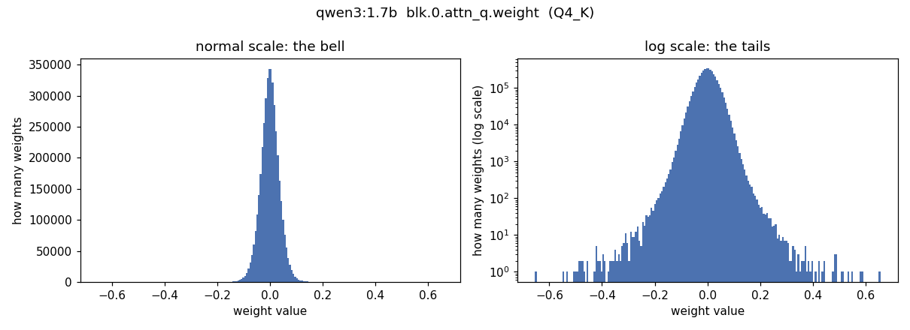
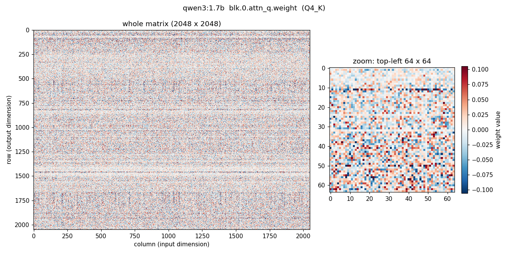
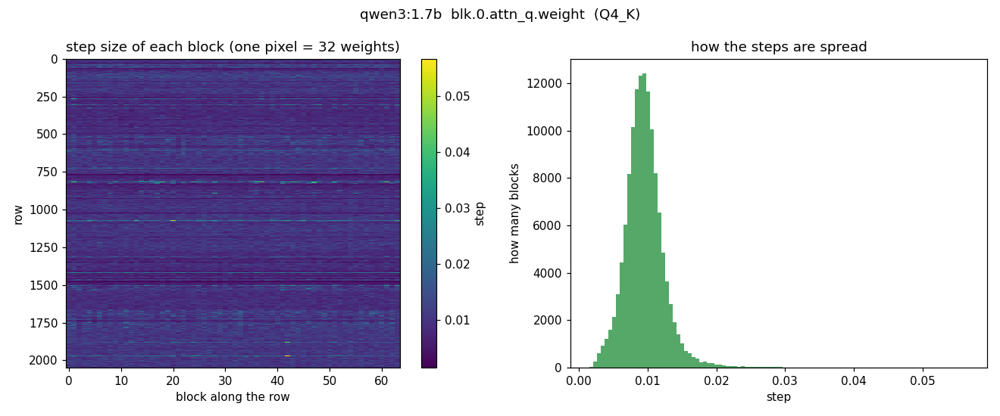
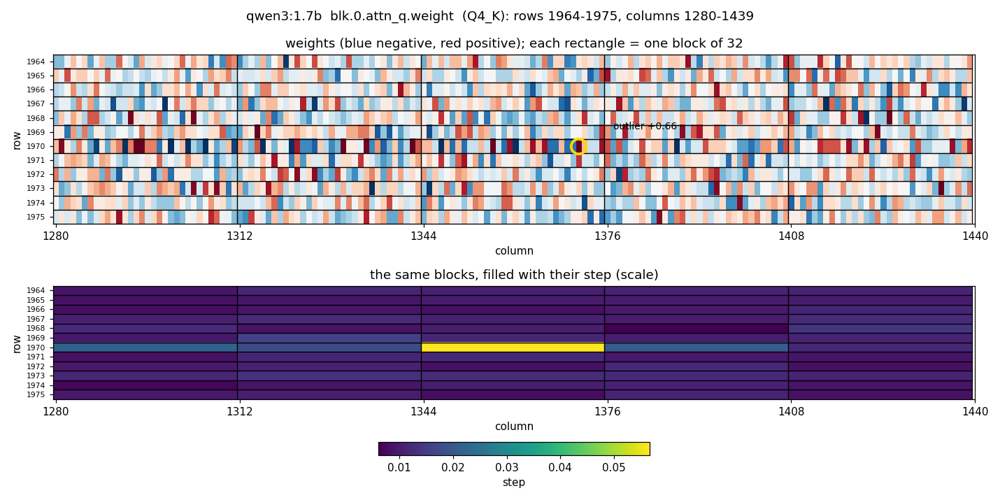
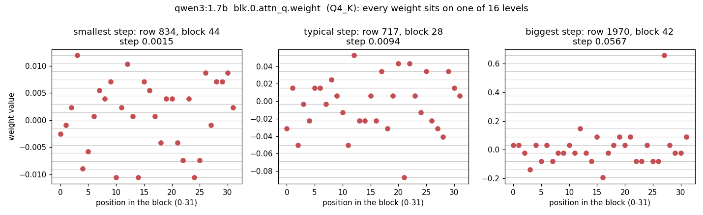

# 008: What does quantization look like, and what does it cost?

**Date:** 2026-11-09 · **Ollama:** 0.40.11 · **Models:** `qwen3:1.7b` (Q4_K_M) and
`qwen3:1.7b-q8_0`, thinking off · **Server:** context 4096, flash attention, `q8_0` KV
cache · **Interface:** [`weights.py`](../../weights.py), `ollama run --verbose`, OpenAI-style
API

## Question

Concept page [4e](../04e-quantization.md) says: weights are bell-shaped with outliers,
stored in blocks of 32 with one scale each, at about 4–5 bits. Is that what the real
file contains? And what does going from 8 to 4 bits cost in size, speed and answers?

## Part 1: the weights themselves

```bash
docker compose run --rm app python weights.py                                 # formats
docker compose run --rm app python weights.py blk.0.attn_q.weight --blocks    # one matrix
```

### Formats inside the files

| Model | Format mix | Average bits/weight | File |
|---|---|---|---|
| `qwen3:1.7b` (Q4_K_M) | Q4_K 73%, Q6_K 24%, F16 3% | **5.33** | 1.36 GB |
| `qwen3:4b-q4_K_M` | Q4_K 77%, Q6_K 21%, F16 2% | **5.20** | 2.61 GB |
| `qwen3:1.7b-q8_0` | Q8_0 97%, F16 3% | **8.72** | 2.22 GB |

Per format, exactly the theory: Q4_K 4.50 bits, Q6_K 6.56, Q8_0 8.50 (32 bytes + a
2-byte scale per 32 weights). The F16 part is the `attn_v` matrices, kept at full
precision in every version.

### One matrix: `blk.0.attn_q.weight` (2048 × 2048, Q4_K)



- Bell-shaped around 0, spread (std) 0.035.
- Heavy tails: the biggest weight is 0.66, 19× the spread; 0.62% beyond 3× the spread
  (a perfect bell curve: 0.27%).



- Mostly noise, plus **horizontal stripes**: rows range from 0.25× to 2.3× the typical
  row. Columns vary much less (0.5× to 1.2×).

### The blocks and their scales

A Q4_K block is 32 **neighbouring weights in one row**. Each block can only hold 16
evenly spaced values; the spacing (the "step") is its scale.



- 131,072 blocks. Steps from 0.0015 to 0.057: **38× apart**. The scale map repeats the
  row stripes: strong rows got coarse grids, faint rows fine ones.
- Every block uses at most 16 distinct values (median 13): the 4-bit grid is real.



- A 12-row window around the biggest outlier, blocks outlined. The outlier (+0.66,
  circled) lights up its own block only (yellow); the neighbouring blocks in the same
  row stay fine-grained. Row 1970 is also a strong row: all its blocks are a bit
  coarser (teal).



- Every weight sits exactly on one of its block's 16 levels.
- **The outlier problem, caught in the act** (right): one weight at 0.66 set this block's
  step to 0.057, and the other 31 weights crowd onto ~5 levels around zero. In the left
  block, with no outlier, a step 38× finer keeps small differences.

## Part 2: Q4_K_M vs Q8_0

### Memory and speed

Same prompt as [experiment 007](007-kv-cache-size.md), 3 runs each.

| Model | Model in memory (GPU + CPU) | Layers on GPU | Writing speed (tokens/s) |
|---|---|---|---|
| Q4_K_M | 717 + 574 MiB | 16 / 29 | 16.8 · 15.3 · 15.4 |
| Q8_0 | 738 + 1373 MiB | **9 / 29** | **10.2 · 10.4 · 10.6** |

Q8 is 1.6× bigger, so 7 fewer layers fit on the GPU, and it writes ~1.5× slower: about
the size ratio, as expected when speed is limited by reading the weights. (Q4 was
18.5 tokens/s in experiment 007 with the same settings; same-run comparisons are what
count.)

### Answers

12 fact questions, temperature 0 (each model always gives its single most likely
answer), "Answer in one short sentence." appended.

| | Q4_K_M | Q8_0 |
|---|---|---|
| Right | **12 / 12** | **11 / 12** |
| Word-for-word identical to the other | 8 / 12 | |

<details>
<summary>The 4 answers that differ</summary>

| Question | Q4_K_M | Q8_0 |
|---|---|---|
| Berlin Wall | The Berlin Wall fell in \*\*1989\*\*. | The Berlin Wall fell in 1989. |
| I promessi sposi | …"I Promessi Sposi" was written by Alessandro Manzoni. | …'I promessi sposi' was written by Alessandro Manzoni. |
| Spider legs | A spider has eight legs. | A spider has 8 legs. |
| Leopardi's birth year | Giacomo Leopardi è nato nel 1798. ✅ | Giacomo Leopardi è nato nel **1813**. ❌ |

(The automatic check marked Q4's "eight legs" wrong because it looked for "8"; corrected
by hand.)

</details>

Paragraph test, "Explain in about 100 words why the sky is blue." Both start the same way
for 17 words, then take different paths:

> common: *The sky appears blue because of the way sunlight interacts with the Earth's
> atmosphere. Sunlight contains various*
> Q4: *wavelengths of light, but shorter wavelengths (like blue and violet) are scattered…*
> Q8: *colors, and when it enters the atmosphere, it collides with molecules and…*

Both full answers are correct (Rayleigh scattering, short wavelengths scattered more).

## What it shows

- **The theory is in the file.** Blocks of 32 neighbours, one scale each, 16 levels per
  block, bits per weight exactly as computed. You can see every weight snap to its
  block's grid.
- **"Q4" means over 5 bits on average.** The "M" mix keeps a quarter of the weights at
  6 bits and `attn_v` at 16. Small models pay more for this.
- **Outliers cost precision for their neighbours**, exactly as the concept page said:
  one big weight coarsens the grid for its whole block. Row-strong stripes are harmless
  (a whole block is strong together); column outliers would hit a block in every row.
- **Q8 is not visibly smarter here, and much slower.** Same score within noise, 1.5×
  slower on this laptop. The 1.7B's knowledge is fragile in both: Q8 got Leopardi's birth
  year wrong, Q4 right. 12 easy questions can't show the small quality loss of Q4; they
  do show it isn't big.
- **Quantization changes the path, not the meaning.** Tiny rounding differences shift
  the probabilities a little; at temperature 0, once a different word wins, the whole
  continuation diverges (here after 17 words). Same mechanism as sampling
  ([4d](../04d-sampling.md)), but deterministic.

Open: why are the rows of `attn_q` so different in strength (row 834 is 0.25× the typical
row)? Each row is one of 16 heads × 128 numbers; position encoding inside each head is
a guess.
