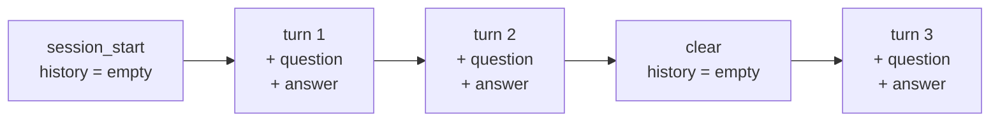

# Traces: recorded chat sessions

Every chat session is saved to `traces/<start time, UTC>.jsonl` by
[`tracing.py`](../tracing.py). It records every question, answer and measurement, so
real conversations can be replayed: the raw material for the dashboard (step 6) and
the visualisations.

- **Not committed**: `traces/` is in `.gitignore`. A trace contains everything you type.
- **Off switch**: `LLM_TRACE=false` in `.env`, or for one run:
  `docker compose run --rm -e LLM_TRACE=false app`.
- **Safe on crashes**: the file is appended after each event.

## Format: JSON Lines

One JSON object per line, one line per event. Every event has `time` (ISO 8601, UTC)
and `event`.

| `event` | When | Other fields |
|---|---|---|
| `session_start` | chat starts | `model`, `base_url`, `context_size`, `thinking_enabled` |
| `turn` | a question was answered | see below |
| `clear` | `/clear` | |
| `interrupted` | Ctrl+C during an answer | `question` |
| `error` | server unreachable, model missing | `error`, `question` |
| `session_end` | chat ends normally | `turns` (answered turns in the current history) |

A `turn` event:

```json
{
  "time": "2026-10-25T22:05:31.464+00:00",
  "event": "turn",
  "turn": 2,
  "question": "What is my name? One word.",
  "answer": "Sam.",
  "thinking": "",
  "stats": {
    "read": 49, "wrote": 3,
    "first_token_s": 0.328, "writing_s": 0.12,
    "tokens_per_second": 25.06, "context_used": 52
  },
  "warning": null
}
```

| Field | Meaning |
|---|---|
| `turn` | counter for this session (keeps counting after `/clear`) |
| `question` | what you typed |
| `answer` | the visible answer (what goes into the history) |
| `thinking` | the reasoning text, `""` when thinking is off (not kept in the history) |
| `stats` | the numbers shown after each answer; see [03-tokens-and-context.md](03-tokens-and-context.md) |
| `warning` | the ⚠ or ✂ text shown, or `null` |

## Only what is new

A turn stores the new question and answer, not the whole history. The model, instead,
receives the whole history with every request: storing it on every line would make the
file grow like 1 + 2 + 3 + … + n (quadratically), repeating the same text over and over.

The exact request of any turn is rebuilt by replaying the events in order:



- `turn`: the request sent was the history so far plus `question`; then `question` and
  `answer` join the history.
- `clear`: the history starts over.
- `interrupted` and `error`: nothing joins the history.

The cost of resending everything still shows up, in the numbers: `stats.read` grows
turn after turn.

## Reading traces

```bash
ls -t traces/ | head                                   # latest sessions
jq -c '{event, turn, read: .stats.read, wrote: .stats.wrote}' traces/<file>.jsonl
jq -r 'select(.event=="turn") | "\(.turn)\t\(.stats.read)\t\(.stats.wrote)"' traces/<file>.jsonl
```

In Python:

```python
import json
events = [json.loads(line) for line in open("traces/<file>.jsonl")]
turns = [e for e in events if e["event"] == "turn"]


def requests(events):
    """Rebuild the exact message list sent in each turn."""
    history = []
    for e in events:
        if e["event"] == "clear":
            history = []
        elif e["event"] == "turn":
            sent = history + [{"role": "user", "content": e["question"]}]
            yield e["turn"], sent
            history = sent + [{"role": "assistant", "content": e["answer"]}]
```
